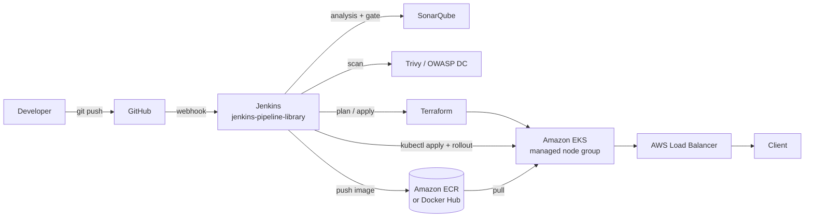

# Spring Boot on Amazon EKS with Jenkins and Terraform

[](https://github.com/ElloughWassim/springboot-terraform-eks/actions/workflows/ci.yml)
[](LICENSE)

An end-to-end delivery project: a small Spring Boot REST service is tested, analysed, containerised, scanned
and deployed to an Amazon EKS cluster that is itself provisioned with Terraform. The whole flow runs in a
Jenkins pipeline built on the [`jenkins-pipeline-library`](https://github.com/ElloughWassim/jenkins-pipeline-library).

## Project overview

The application is intentionally simple. The point of the project is the delivery chain around it:

| Layer | What it demonstrates |
|---|---|
| Application | Spring Boot 4.1 on Java 21, externalised configuration, health probes, graceful shutdown |
| Tests | Fast unit tests (Surefire) and HTTP integration tests on a random port (Failsafe) |
| Container | Multi-stage, layered, non-root image with a health check |
| Kubernetes | Restricted Pod Security, read-only root filesystem, probes, resource requests, zero-downtime rolling updates |
| Infrastructure | Terraform: EKS with KMS-encrypted secrets, control-plane logging, access entries, private API by default, managed node group, immutable ECR repository |
| CI/CD | Jenkins: SonarQube gate, OWASP Dependency-Check, Trivy (fs, IaC, image), ECR or Docker Hub push, approved Terraform plans, rollout with automatic rollback |

## Main features

- `GET /home/data` returns configuration-driven data. Values come from a Kubernetes ConfigMap.
- `/actuator/health/liveness` and `/actuator/health/readiness` serve the Kubernetes probes.
- One pipeline parameter switches the registry between **Amazon ECR** and **Docker Hub**.
- Terraform changes are planned, archived for review and applied only after manual approval.
- Every build produces an immutable image tag `<build number>-<git sha>`.

## Technologies and tools

Java 21 · Spring Boot 4.1 · Maven (Wrapper) · JUnit 5 · Docker · Kubernetes · Amazon EKS · Amazon ECR ·
Terraform · Jenkins · SonarQube · OWASP Dependency-Check · Trivy · GitHub Actions · Dependabot

## Architecture overview



## Repository structure

```
.
├── src/main/java/io/github/elloughwassim/eksdemo/
│   ├── EksDemoApplication.java     # Entry point
│   ├── AppDataProperties.java      # app.data.* configuration (record)
│   └── HomeController.java         # GET /home/data
├── src/main/resources/application.yml
├── src/test/java/.../              # *Test = unit (Surefire), *IT = integration (Failsafe)
├── k8s/                            # Namespace, ConfigMap, Deployment, Service (applied in order)
├── terraform/                      # EKS cluster, node group, IAM, KMS, ECR
├── Dockerfile                      # Multi-stage, layered, non-root
├── Jenkinsfile                     # Delivery pipeline (uses the shared library)
├── .github/workflows/ci.yml        # Build, tests, image smoke test, Trivy, Terraform, kubeconform, gitleaks
└── mvnw, .mvn/                     # Maven Wrapper 3.3.4 → Maven 3.9.16
```

## Prerequisites

| For | You need |
|---|---|
| Local build | JDK 21+ (Maven is downloaded by the wrapper) |
| Container | Docker 24+ with BuildKit |
| Infrastructure | Terraform 1.6+ (or OpenTofu), AWS account, an existing VPC with two private subnets, an S3 bucket for state |
| Pipeline | Jenkins with the plugins listed in [CI/CD pipeline](#cicd-pipeline) |

## Installation

```bash
git clone https://github.com/ElloughWassim/springboot-terraform-eks.git
cd springboot-terraform-eks
./mvnw -B verify          # compile, unit tests, integration tests, package
```

## Configuration

| Property | Environment variable | Default (local) | Kubernetes value |
|---|---|---|---|
| `app.data.name` | `APP_DATA_NAME` | `local` | `springboot-demo` |
| `app.data.value` | `APP_DATA_VALUE` | `default-value` | `deployed-by-jenkins` |
| `app.data.place` | `APP_DATA_PLACE` | `localhost` | `amazon-eks` |

Kubernetes values live in `k8s/10-configmap.yaml`. Infrastructure values live in `terraform/terraform.tfvars`
(copy `terraform.tfvars.example`) and `terraform/backend.hcl` (copy `backend.hcl.example`). Both files are
git-ignored.

## How to run the project

```bash
# 1. Plain Java
./mvnw spring-boot:run
curl http://localhost:8080/home/data
# {"id":1,"name":"local","place":"localhost","value":"default-value"}

# 2. Docker
docker build -t springboot-terraform-eks .
docker run --rm -p 8080:8080 -e APP_DATA_NAME=docker springboot-terraform-eks

# 3. Any Kubernetes cluster (replace the image placeholder yourself when not using Jenkins)
sed 's|IMAGE_PLACEHOLDER|<your-image>|' k8s/20-deployment.yaml > /tmp/deployment.yaml
kubectl apply -f k8s/00-namespace.yaml -f k8s/10-configmap.yaml -f /tmp/deployment.yaml -f k8s/30-service.yaml
kubectl -n springboot-demo get svc springboot-demo      # EXTERNAL-IP of the load balancer

# 4. Provision EKS manually
cd terraform
terraform init -backend-config=backend.hcl
terraform plan -out=tfplan && terraform apply tfplan
aws eks update-kubeconfig --region <AWS_REGION> --name springboot-demo-eks
```

## How to execute tests

```bash
./mvnw test                         # unit tests only
./mvnw verify                       # unit + integration tests
./mvnw verify -DskipUTs=true        # integration tests only (what the Jenkins stage runs)
```

## CI/CD pipeline

### Jenkins (`Jenkinsfile`)

```
Unit tests → Integration tests → SonarQube → Quality gate → OWASP Dependency-Check → Trivy fs → Trivy IaC
  → Docker build → Trivy image → Push (ECR | Docker Hub)
  → [Terraform plan → manual approval → apply]   (PROVISION_INFRA or destroy-infrastructure)
  → Deploy to EKS (render image, apply, rollout status, automatic rollback)
```

| Parameter | Values |
|---|---|
| `ACTION` | `build-and-deploy`, `build-only`, `destroy-infrastructure` |
| `REGISTRY` | `ecr` (immutable tags) or `dockerhub` (`latest` also pushed) |
| `PROVISION_INFRA` | run Terraform before deploying |

**Jenkins setup:**

- **Plugins:** Pipeline, Git, Credentials Binding, Pipeline: AWS Steps (or CloudBees AWS Credentials), SonarQube Scanner,
  OWASP Dependency-Check, JUnit, Timestamper.
- **Agent tools:** JDK 21, Docker, Trivy, AWS CLI v2, Terraform ≥ 1.6, kubectl.
- **Tools / servers:** SonarQube server named `sonarqube` (with a webhook to `<JENKINS_URL>/sonarqube-webhook/`).
  Dependency-Check installation named `dependency-check`.
- **Shared library:** `jenkins-pipeline-library` (see its README).
- **Credentials:**

| Id | Kind | Purpose |
|---|---|---|
| `aws-credentials` | AWS Credentials | ECR push, Terraform, `aws eks update-kubeconfig` |
| `dockerhub-credentials` | Username + access token | Docker Hub push |
| `nvd-api-key` | Secret text | Faster NVD updates for Dependency-Check |
| `terraform-backend-hcl` | Secret file | Content of `backend.hcl` |
| `terraform-tfvars` | Secret file | Content of `terraform.tfvars` |

Replace `<AWS_ACCOUNT_ID>` and `<DOCKERHUB_NAMESPACE>` in the `environment` block of the `Jenkinsfile`
(or define them globally in Jenkins). The library rejects unreplaced placeholders with a clear error.

The IAM identity behind `aws-credentials` must also be granted access to the cluster (an EKS access entry).
The identity that creates the cluster gets admin access automatically.

### GitHub Actions (`.github/workflows/ci.yml`)

These checks need no cloud credentials: Maven verify, Docker build + smoke test, Trivy image/fs/IaC scans,
`terraform fmt`/`validate`, kubeconform and gitleaks.

## Security considerations

- No credentials are stored in the repository, Terraform variables or state. AWS access comes from the
  environment (Jenkins credential, instance role or OIDC). Account-specific values are git-ignored files.
- The Kubernetes API endpoint is **private by default**. Public access requires an explicit CIDR allowlist
  (`0.0.0.0/0` is rejected).
- EKS secrets are encrypted with a customer-managed, rotating KMS key. All control-plane log types are enabled.
- ECR tags are immutable, scanned on push and expire after 30 images.
- Pods run as UID 10001 with no privilege escalation, all capabilities dropped, a read-only root filesystem,
  the `RuntimeDefault` seccomp profile and no service-account token. The namespace enforces the `restricted`
  Pod Security Standard.
- Trivy and the SonarQube gate fail the pipeline on findings. `.trivyignore` documents the only accepted exception.
- `terraform destroy` keeps the ECR repository if it still contains images (`force_delete = false`).
  Delete the images first if you really want it removed.

## License and attribution

Released under the [MIT License](LICENSE).

This project is an independent re-implementation by ElloughWassim. It was inspired by
[`iam-vikash/mrdevops_java_app`](https://github.com/iam-vikash/mrdevops_java_app), a tutorial project by Vikash
whose sample application was itself based on a Spring Cloud Kubernetes demo by Eresh Gorantla. That repository
has no license, so no code was copied. The application, tests, Dockerfile, manifests, Terraform and pipeline here
were written from scratch. The `/home/data` endpoint and its response fields deliberately match the original
behavior, and the configuration key that populates `value` is now called `app.data.value` (originally `app.data.test`).

The Maven Wrapper scripts (`mvnw`, `mvnw.cmd`) are © The Apache Software Foundation, Apache License 2.0.

## Maintainer

**ElloughWassim**, [github.com/ElloughWassim](https://github.com/ElloughWassim)
