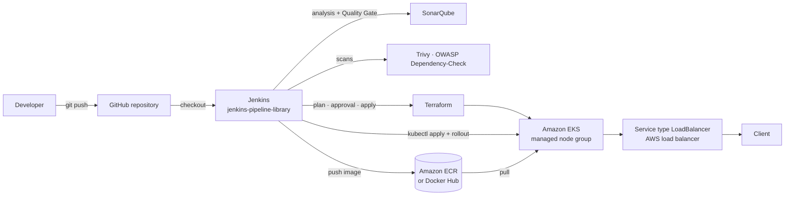

# Spring Boot on Amazon EKS with Jenkins and Terraform

An end-to-end delivery project: a small Spring Boot REST service is tested, analysed, containerised, scanned
and deployed to an Amazon EKS cluster provisioned with Terraform. The delivery flow runs in a Jenkins
pipeline built on the `jenkins-pipeline-library` shared library (`v1.0.0`).

## Table of Contents

- [Project Overview](#project-overview)
- [Key Features](#key-features)
- [Architecture Overview](#architecture-overview)
- [Technology Stack](#technology-stack)
- [Project Structure](#project-structure)
- [Prerequisites](#prerequisites)
- [Installation and Configuration](#installation-and-configuration)
- [Execution and Deployment](#execution-and-deployment)
- [Testing and Validation](#testing-and-validation)
- [CI/CD Pipeline](#cicd-pipeline)
- [Security Implementation](#security-implementation)
- [License](#license)
- [Author](#author)

## Project Overview

The application is intentionally simple. The focus of the project is the delivery chain around it.

| Layer | Implementation |
|---|---|
| Application | Spring Boot 4.1 on Java 21, externalised configuration, Actuator health probes, graceful shutdown |
| Tests | Unit tests (Surefire) and HTTP integration tests on a random port (Failsafe) |
| Container | Multi-stage, layered, non-root image with a health check |
| Kubernetes | `restricted` Pod Security Standard, read-only root filesystem, probes, resource requests and limits, rolling updates with `maxUnavailable: 0` |
| Infrastructure | Terraform: EKS with KMS-encrypted secrets, control-plane logging, access entries, private API endpoint by default, managed node group, immutable ECR repository |
| CI/CD | Jenkins: SonarQube Quality Gate, OWASP Dependency-Check, Trivy (fs, IaC, image), ECR or Docker Hub push, reviewed and approved Terraform plans, rollout with automatic rollback |

## Key Features

- `GET /home/data` returns configuration-driven data. In Kubernetes, the values come from a ConfigMap.
- `/actuator/health/liveness` and `/actuator/health/readiness` serve the Kubernetes probes.
- One pipeline parameter switches the registry between **Amazon ECR** and **Docker Hub**.
- Terraform changes are planned, archived as `tfplan.txt` for review and applied only after manual approval.
- Every build produces an immutable image tag `<build number>-<git sha>`.

## Architecture Overview



## Technology Stack

| Area | Tools |
|---|---|
| Application | Java 21, Spring Boot 4.1 (Web MVC, Actuator) |
| Build and tests | Maven Wrapper (Maven 3.9.16), JUnit Jupiter, AssertJ, Surefire, Failsafe |
| Container | Docker (BuildKit), Eclipse Temurin 21 base images |
| Infrastructure | Terraform, AWS provider `~> 6.0`, Amazon EKS, Amazon ECR, AWS KMS, S3 remote state |
| Orchestration | Kubernetes |
| CI/CD | Jenkins, GitHub Actions, Dependabot |
| Quality and security | SonarQube, OWASP Dependency-Check, Trivy, kubeconform, Gitleaks |

## Project Structure

```text
.
├── src/main/java/io/github/elloughwassim/eksdemo/
│   ├── EksDemoApplication.java     # Entry point
│   ├── AppDataProperties.java      # app.data.* configuration (record)
│   └── HomeController.java         # GET /home/data
├── src/main/resources/application.yml
├── src/test/java/io/github/elloughwassim/eksdemo/
│   ├── HomeControllerTest.java     # Unit test (Surefire)
│   ├── EksDemoApplicationTest.java # Spring context test (Surefire)
│   └── HomeEndpointIT.java         # HTTP integration test (Failsafe)
├── k8s/                            # 00-namespace, 10-configmap, 20-deployment, 30-service
├── terraform/                      # EKS cluster, node group, IAM, KMS, ECR, S3 backend
├── Dockerfile                      # Multi-stage, layered, non-root
├── Jenkinsfile                     # Delivery pipeline (uses the shared library)
├── .github/workflows/ci.yml        # Build, tests, image smoke test, Trivy, Terraform, kubeconform, Gitleaks
├── .github/dependabot.yml
├── .trivyignore                    # Single documented exception
└── mvnw, mvnw.cmd, .mvn/           # Maven Wrapper 3.3.4 → Maven 3.9.16
```

## Prerequisites

| For | Requirement |
|---|---|
| Local build | JDK 21 or newer (Maven is downloaded by the wrapper; the build enforces Java 21+ and Maven 3.9+) |
| Container | Docker with BuildKit enabled (the Dockerfile uses `RUN --mount=type=cache`) |
| Infrastructure | Terraform, an AWS account, an existing VPC with at least two private subnets in different Availability Zones, an S3 bucket for the remote state |
| Pipeline | Jenkins with the plugins, tools and credentials listed in [CI/CD Pipeline](#cicd-pipeline) |

> **Terraform version.** `versions.tf` declares `>= 1.6.0`, but `backend.hcl.example` enables S3 native
> locking (`use_lockfile = true`), which older Terraform releases do not support. Use a Terraform release that
> supports `use_lockfile` (1.11 or newer recommended), or remove that line from your `backend.hcl`.

## Installation and Configuration

```bash
git clone https://github.com/ElloughWassim/springboot-terraform-eks.git
cd springboot-terraform-eks
./mvnw -B verify          # compile, unit tests, integration tests, package
```

### Application configuration

| Property | Environment variable | Local default | Kubernetes value (`k8s/10-configmap.yaml`) |
|---|---|---|---|
| `app.data.name` | `APP_DATA_NAME` | `local` | `springboot-demo` |
| `app.data.value` | `APP_DATA_VALUE` | `default-value` | `deployed-by-jenkins` |
| `app.data.place` | `APP_DATA_PLACE` | `localhost` | `amazon-eks` |

### Infrastructure configuration

| File | Source | Content |
|---|---|---|
| `terraform/terraform.tfvars` | copy of `terraform.tfvars.example` | Region, cluster name, subnet IDs, node instance types, optional public endpoint CIDRs |
| `terraform/backend.hcl` | copy of `backend.hcl.example` | S3 bucket, state key, region, encryption, locking |

Both files are git-ignored. In Jenkins they are provided as *Secret file* credentials.

Main Terraform variables (defaults from `variables.tf`):

| Variable | Default |
|---|---|
| `aws_region` | `eu-west-1` |
| `cluster_name` | `springboot-demo-eks` |
| `kubernetes_version` | `1.36` |
| `subnet_ids` | required, at least two |
| `endpoint_public_access` | `false` |
| `node_instance_types` | `["t3.medium"]` |
| `node_desired_size` / `node_min_size` / `node_max_size` | `2` / `1` / `3` |
| `create_ecr_repository` | `true` |
| `ecr_repository_name` | `springboot-terraform-eks` |

## Execution and Deployment

```bash
# 1. Plain Java
./mvnw spring-boot:run
curl http://localhost:8080/home/data
# {"id":1,"name":"local","place":"localhost","value":"default-value"}

# 2. Docker
docker build -t springboot-terraform-eks .
docker run --rm -p 8080:8080 -e APP_DATA_NAME=docker springboot-terraform-eks

# 3. Any Kubernetes cluster (replace the image placeholder yourself when not using Jenkins)
sed 's|IMAGE_PLACEHOLDER|<your-image>|' k8s/20-deployment.yaml > /tmp/deployment.yaml
kubectl apply -f k8s/00-namespace.yaml -f k8s/10-configmap.yaml -f /tmp/deployment.yaml -f k8s/30-service.yaml
kubectl -n springboot-demo get svc springboot-demo      # EXTERNAL-IP of the load balancer

# 4. Provision EKS manually
cd terraform
terraform init -backend-config=backend.hcl
terraform plan -out=tfplan && terraform apply tfplan
aws eks update-kubeconfig --region <AWS_REGION> --name springboot-demo-eks
```

The Kubernetes API endpoint is private by default, so `kubectl` must run from inside the VPC unless
`endpoint_public_access` is enabled for specific CIDR blocks.

## Testing and Validation

```bash
./mvnw test                         # unit tests only
./mvnw verify                       # unit + integration tests
./mvnw verify -DskipUTs=true        # integration tests only (what the Jenkins stage runs)
```

| Test | Type | What it checks |
|---|---|---|
| `HomeControllerTest` | Unit | Controller output without a Spring context |
| `EksDemoApplicationTest` | Unit (Spring context) | Context startup and `app.data.*` binding |
| `HomeEndpointIT` | Integration | `GET /home/data` and both health probes over HTTP on a random port |

## CI/CD Pipeline

### Jenkins (`Jenkinsfile`)

```text
Unit tests → Integration tests → SonarQube → Quality gate → OWASP Dependency-Check → Trivy fs → Trivy IaC
  → Docker build → Trivy image → Push (ECR | Docker Hub)
  → [Terraform plan → manual approval → apply]     (PROVISION_INFRA=true, or ACTION=destroy-infrastructure)
  → Deploy to EKS (render image, apply, rollout status, automatic rollback)
```

| Parameter | Values |
|---|---|
| `ACTION` | `build-and-deploy`, `build-only` (stops after the push), `destroy-infrastructure` (Terraform `plan -destroy` + approval + apply) |
| `REGISTRY` | `ecr` (only the immutable tag is pushed) or `dockerhub` (`latest` is also pushed) |
| `PROVISION_INFRA` | Run Terraform plan/apply before deploying (with `build-and-deploy`) |

**Jenkins setup**

- **Plugins:** Pipeline, Git, Credentials Binding, Pipeline: AWS Steps (or AWS Credentials), SonarQube Scanner,
  OWASP Dependency-Check, JUnit, Timestamper.
- **Agent tools:** JDK 21, Docker, Trivy, AWS CLI v2, Terraform, kubectl.
- **Servers and tools:** a SonarQube server named `sonarqube` with a webhook to
  `<JENKINS_URL>/sonarqube-webhook/`, and a Dependency-Check installation named `dependency-check`.
- **Shared library:** `jenkins-pipeline-library`, pinned to `v1.0.0`.
- **Environment:** replace `<AWS_ACCOUNT_ID>` and `<DOCKERHUB_NAMESPACE>` in the `environment` block of the
  `Jenkinsfile` (or define them globally in Jenkins). Unreplaced placeholders fail the library's validation.

| Credential ID | Kind | Purpose |
|---|---|---|
| `aws-credentials` | AWS Credentials | ECR push, Terraform, `aws eks update-kubeconfig` |
| `dockerhub-credentials` | Username with password (access token) | Docker Hub push |
| `nvd-api-key` | Secret text | NVD API key for Dependency-Check |
| `terraform-backend-hcl` | Secret file | Content of `backend.hcl` |
| `terraform-tfvars` | Secret file | Content of `terraform.tfvars` |

The IAM identity behind `aws-credentials` must have access to the cluster. Terraform grants admin access to
the identity that creates the cluster (`bootstrap_cluster_creator_admin_permissions = true`); any other
identity needs an EKS access entry.

### GitHub Actions (`.github/workflows/ci.yml`)

Runs on pushes to `main` and on pull requests, without cloud credentials:

| Job | Checks |
|---|---|
| Maven build and tests | `./mvnw -B -ntp verify`, test reports uploaded as artifacts |
| Docker image and Trivy scans | Image build, smoke test (`/actuator/health/readiness`, `/home/data`), Trivy image scan (fixable HIGH/CRITICAL), Trivy fs scan (vulnerabilities, secrets, misconfigurations, MEDIUM and above) |
| Terraform and Kubernetes validation | `terraform fmt -check`, `terraform validate`, kubeconform on `k8s/` |
| Secret scan | Gitleaks over the full history |

Dependabot checks Maven, Docker, Terraform and GitHub Actions dependencies weekly.

## Security Implementation

- **No credentials in the repository.** The AWS provider reads credentials from the environment (Jenkins
  credential, instance role or OIDC). Account-specific Terraform files are git-ignored.
- **Private API endpoint by default.** Public access requires an explicit CIDR allowlist, and `0.0.0.0/0` is
  rejected by variable validation.
- **EKS hardening.** Secrets are encrypted with a customer-managed KMS key with rotation enabled. All
  control-plane log types are enabled. Access uses EKS access entries (`authentication_mode = "API"`).
- **ECR.** Immutable tags, scan on push, KMS encryption, lifecycle policy keeping the 30 most recent images.
- **Pod security.** UID 10001, `runAsNonRoot`, no privilege escalation, all capabilities dropped, read-only
  root filesystem (`/tmp` is an `emptyDir`), `RuntimeDefault` seccomp profile, no service-account token. The
  namespace enforces the `restricted` Pod Security Standard.
- **Pipeline gates.** Trivy, Dependency-Check (CVSS ≥ 7) and the SonarQube Quality Gate fail the pipeline.
  `.trivyignore` documents the only accepted exception (`KSV-0013`, the image placeholder).
- **Safe destroy.** The ECR repository uses `force_delete = false`, so `terraform destroy` fails while it
  still contains images.

## License

This project is licensed under the MIT License. See [`LICENSE`](LICENSE).

Copyright (c) 2026 ElloughWassim.

## Author

**ElloughWassim** · [github.com/ElloughWassim](https://github.com/ElloughWassim)
